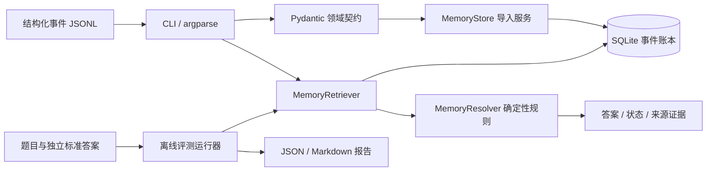

# RepoMind P0 架构与数据契约

状态：P0 设计基线，2026-10-26。实施依据为用户指定的执行提示词；规划归档用于解释决策。本文规定 V1，后续版本仅保留适配方向。

## 模块与边界



`domain/models.py` 负责字段、类型、时间、事件约束；`memory/store.py` 负责完整批次校验与导入；`adapters/sqlite.py` 实现事务、持久化和精确过滤；`memory/resolver.py` 只做纯状态推导；`memory/retriever.py` 连接候选检索和规则解析；`evaluation/` 读取题目、评分和生成报告；`cli.py` 负责命令和可诊断错误。

边界采用少量协议：Store 提供批次写入、按键读取事件；Resolver 接收 Query 和候选事件并返回 QueryResult；Retriever 提供 query(Query)。不为尚不存在的 Agent、向量服务或平台设计通用插件框架。

## 事件契约

JSONL 每个非空行是一条 JSON 对象；字段未知、JSON 语法错误和字段错误须带文件名与行号。所有标识和值必须为非空字符串。事件 ID 全库唯一，作用域键为 `(project_id, subject, predicate)`，大小写精确匹配。

| 字段 | V1 约束 |
|---|---|
| event_id | 稳定唯一 ID；同 ID 同规范化内容重复写入为幂等，同 ID 不同内容整批失败 |
| project_id | 项目隔离键；必须明确给出，不能用全局默认值推断 |
| subject | 事实主体，示例 `project` |
| predicate | 属性名，示例 `database` |
| value | 非空字符串；V1 不推断单位、别名、语义等价 |
| event_type | `declare` / `plan` / `complete` / `correct` |
| observed_at | 含时区的 ISO 8601 时间戳；表示来源观察/记录时间 |
| effective_at | 可选，默认 observed_at；表示事实生效时间。plan 可指向未来，其他类型不得晚于 observed_at |
| source_id | 来源会话/文档 ID；不等价于经过外部认证的证据 |
| supersedes_event_id | correct 必须填写；其他类型不得填写 |

时间写入时统一 UTC；原始 JSON 文本仍保留。V1 不根据本机时区补齐无时区时间。不能把计划日期当成完成日期。correct 必须指向已存在或同批次的非 plan 事件，目标键和 effective_at 必须一致，observed_at 不得早于目标。拒绝自引用、悬空引用、跨键替代和纠错循环；先校验整个批次再提交，因此 JSONL 行顺序不决定纠错合法性。

示例：

```json
{"event_id":"campus-db-plan","project_id":"CampusRecruit","subject":"project","predicate":"database","value":"PostgreSQL","event_type":"plan","observed_at":"2026-03-01T09:00:00Z","effective_at":"2026-04-01T00:00:00Z","source_id":"campus-session-mar"}
```

## ADD 数据流

1. CLI 读取 UTF-8 JSONL，保留原始行文本并解析为事件。
2. Pydantic 校验字段、时间、事件类型。导入服务检查批次内部重复和纠错引用。
3. 开启 SQLite 写事务，在同一事务中合并已存 ID、验证全局引用和幂等约束。
4. 任一错误整批回滚。合法新事件插入账本；返回 inserted、duplicates 计数。

SQLite 保存事件内容、原始 JSON、时间、来源和替代关系；不直接改写原事实。按 project_id / subject / predicate 建索引。SQL 使用参数绑定。数据库 schema 版本由适配器管理；不自动丢弃未知版本数据库。不承诺远程多租户、认证或加密。

## SEARCH 数据流与时间规则

Query 必须包含 project_id、predicate、as_of；subject 默认 `project`。CLI `--field` 为 predicate 的用户入口。as_of 接受含时区时间戳或 `YYYY-MM-DD`；日期表示 UTC 当日 23:59:59.999999。known_at 可选，采用相同日期规则，表示可使用的观察记录截止时间；默认不限制。

1. SQLiteMemoryStore.list_events(query) 按完整作用域键及可选 known_at 筛选全部该键历史；retriever 不跨项目回退。
2. Resolver 按 `effective_at <= as_of` 筛选事实；若指定 known_at，候选已满足 `observed_at <= known_at`。plan_event_ids 仅展示 observed_at <= as_of 的可见计划，未来计划生效日期不影响展示；计划绝不进入事实状态。
3. 应用当前可见 correct 的显式替代关系。被替代的旧事件仍留在账本。
4. 剩余事实选择最大的 effective_at。该时间所有事件 value 相同则返回 ok，并联合所有支持证据；存在不同值则返回 insufficient_evidence 和冲突证据。
5. 没有事实返回 unknown，reason 区分缺记录与只有计划。事件 ID 或文件顺序不能打破冲突；observed_at 较晚不能自动证明同时间事实更可信。

默认历史查询是“用当前所有已知记录重建过去的有效状态”。`known_at` 回答“当时所知”。例如 5 月纠正 1 月错误：查询 2 月默认使用纠正值；指定 known_at=2 月则仍返回当时的旧值。4 月新生效的数据库事实不会因为纠正了 1 月事实而丢失。

QueryResult 至少含 status（ok / unknown / insufficient_evidence）、value（仅 ok 非空）、reason、evidence、considered_event_ids。evidence 为完整 Event 列表，仅含最终活跃候选；包含 event_id、source_id、project_id 以及事实键和值、时间，足以回查账本。被纠错目标仅保留于存储及 considered_event_ids，不作为直接答案证据。plan_event_ids 若提供只表示已观察计划，不代表计划已生效。冲突值不通过字符串拼接伪造成确定答案。

## 评测边界

评测在新建的隔离 SQLite 数据库导入 fixture，逐题执行结构化查询。标准答案不传入 retriever/resolver。可将同一题的多个查询作为合取检查，用于跨会话关联。评分必须校验 status、value、预期证据集合和引用合法性；报告候选漏检、解析错误、引用错误的阶段差异。保存配置、文件 SHA-256 和运行时间。基线为按 observed_at 取最后记录的简单负对照。

## 参考架构研究与适配方向

以下是 2026-10-26 访问的官方文档/仓库 README，页面未固定 commit 或 SDK 版本；未安装这些项目、未审阅其运行实现、未验证其性能或集成兼容性。

- Mem0：官方 ADD 文档描述从消息抽取事实、保存并供后续检索；SEARCH 描述向量候选、作用域过滤和可选排序。V1 借鉴写入/检索边界与范围隔离，使用人工结构化事件和确定性规则。去重、纠错的本项目规则由本文定义，不能据此声称复现 Mem0 内部冲突算法。[ADD](https://docs.mem0.ai/core-concepts/memory-operations/add)、[SEARCH](https://docs.mem0.ai/core-concepts/memory-operations/search)。
- OpenViking：官方 README 用虚拟文件系统统一组织资源、记忆、技能，并按摘要 L0、概览 L1、详情 L2 按需加载。V1 借鉴可检查来源和项目边界；不实现层级摘要或语义路径检索。未来 V2.1 才评估适配器。[官方 README](https://github.com/volcengine/OpenViking/blob/main/README.md)。
- Langfuse：官方评测文档将 trace、固定 dataset、experiment 与 score 联系起来。V1 将相同思想落为本地题目、运行配置和逐题结果，不接入平台。V1.2 才考虑导出适配。[Evaluation Overview](https://langfuse.com/docs/evaluation/overview)。
- Harness²、Dream-RSI：本轮仅依据用户提供的规划归档理解为候选策略评估和历史重放方向，未检索或核验论文原文，不据此作技术事实或效果断言；不实施优化循环。

V1.1 仅规划事件入口前的事实提取与检索候选增强，仍须保留隔离、时间规则和来源契约。V1.2 及以后必须独立授权并通过对应验收。V1 验收后停止开发。

