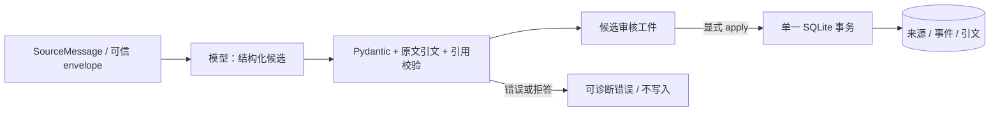
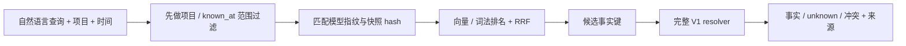

# 阶段目标：完成 V1.1 Intelligent Memory，保持 V1 规则与审计能力

设计基线：2026-10-27；工作分支 `feature/v1.1-intelligent-memory`。本阶段将自然语言转为可审核的结构化候选，并通过 Embedding 与词法混合检索发现事实键，最后仍由 V1 规则决定项目事实。交付必须区分离线工程验证与真实模型验收。

## 本阶段交付与边界

| 本阶段要交付 | 验收证据 |
|---|---|
| 自然语言来源封装、模型候选提取、原文引文检查、显式 apply 写入 | 候选审核工件、来源/事件/引文原子事务测试 |
| OpenAI 兼容 / DeepSeek Chat 与独立 embeddings HTTP 适配 | 协议测试；录制响应回放；分开配置与验证真实服务 |
| 项目内、观察时间快照内的向量索引与词法混合排序 | 缓存重启、失效、维度、模型隔离及候选召回测试 |
| 完整 V1 resolver 处理命中的事实键 | 计划不冒充事实、历史/当前/纠错/冲突与来源回归 |
| 分别测量提取、检索、端到端错误 | 独立冻结开发/保留数据、机器可读与 Markdown 报告 |
| 保留 V1 数据、测试、报告和运行入口 | 原 V1 回归全部通过，旧基线报告不被覆盖 |

本阶段不接入 Langfuse 或 Mem0，不部署平台、云服务和 GUI，不实现代码修改 Agent、OpenViking 层级上下文或 Harness 自优化。V1.2、V2、V3 仍需独立授权。

## 第一步：确定契约，保留 V1 为事实内核

继续使用 Python、Pydantic、SQLite、argparse、pytest。新增的模型输出只能成为候选，不能直接修改当前值。`project_id`、`source_id`、`observed_at` 来自调用者提供的可信 envelope；“可信”表示应用指定且不由模型产生，不表示本项目已经认证来源真实性。

SourceMessage 至少包含 project_id、source_id、observed_at、text。自然语言 text 是待分析数据，其中的命令或“改为另一项目”不能改变 envelope。模型仅提出 subject、predicate、value、event_type、effective_at、supersedes_event_id、evidence_text。

Pydantic 拒绝未知字段、非法状态和时间；evidence_text 必须是该来源原文中的精确非空片段。精确引用只能证明片段存在，不能保证模型理解正确，因此需要候选审核与独立提取评测。无法支持的事实返回空候选/拒答，不补写猜测。日期不能根据今天、本机时区或计划截止时间推断；没有明确回溯日期时，以观察时间记录当前声明，不伪造更早的生效日。

correct 必须指向已有的同项目、同主体、同属性、同生效时间的非 plan 事件；候选未给生效时间时只能继承这个明确目标的时间，不能按当前观察日改写原历史。不能凭模型自造 ID 替代记录，也不能让计划通过纠错晋升事实。辅助冲突分类只形成 event_type 和目标候选；同刻矛盾、计划与事实的最终裁决仍遵守 V1。

## 第二步：提取、审核、原子写入

默认输出可审阅的候选工件；只有显式 apply 才写入来源、事件和引文。整个批次全部校验通过才提交，任一条失败整批回滚。稳定事件 ID 与来源内容约束支持重复操作幂等，不能用重试悄悄覆盖账本。同 ID 不同内容、来源 ID 内容不一致和悬空纠错须拒绝。

候选工件必须标明来源、模型与提取配置，可回查原文；不得写入 API key。具体 CLI 命令以最终 README 为准，本设计不把未实现命令示例当作已验证路径。

## 第三步：接入显式配置的模型服务

用标准库 urllib 发送 Chat Completions 与独立 embeddings 请求，不新增 SDK 或 NumPy。支持的 OpenAI 模式使用 strict JSON Schema；用户选择的 DeepSeek 显式使用 JSON mode（json_object）、max_tokens 和 thinking disabled，再由本地 Pydantic 校验。模型拒绝、截断、空输出、无效 JSON 和字段错误均可诊断失败，不静默降级为自由文本解析。该变化及替代比较见 ADR0008。

base URL 与模型 ID 必须显式配置；不猜服务商、模型、价格或账户权限。HTTP 只允许 localhost/回环开发服务，其他地址要求 HTTPS；不在异常信息或报告输出密钥，不隐藏重试。实际兼容程度必须用所选服务验证，不能因名称含“OpenAI compatible”就认定支持 strict schema 和 embeddings。

用户已选择 DeepSeek 并将通过项目根 .env 提供聊天配置；设计文档本身不代表 live 已运行。chat 与 embedding 的服务地址、模型和 key 分离：本轮核验的 DeepSeek 参考未提供 embeddings 契约，单个聊天 key 只可验证提取及显式 lexical 检索，不能假定向量服务也可用。离线录制响应是 test double，只验证协议与工程机制；真实配置到位后追加分项 live 报告，不覆盖离线结果。

## 第四步：建立观察时间快照与混合检索

索引的单位是事实键 `(project_id, subject, predicate)`。先按项目和可选 known_at 过滤历史，再将该快照中的 predicate 与历史 values 编成文档，计算 Embedding。记录模型指纹、文档 SHA-256 和维度；缓存允许同键的多个文本快照并存。

查询按相同 project_id / known_at 构建目标文档快照；仅使用指纹和 hash 均匹配的完整缓存。源事件变化、known_at 变化或模型变化导致缓存不匹配时，明确提示重新 index，不在 search 内默默批量调用模型补索引。这样既限制隐式成本，也避免审计查询的排序受未来观察记录影响。

向量相似度与词法匹配分别排序，用 Reciprocal Rank Fusion（RRF）融合事实键。命中事实键后，加载该键完整且受 known_at 约束的事件交给 V1 resolver，再按 as_of 解析有效事实。相似的旧值或迁移计划可以帮助找键，不能因此成为当前答案。

索引允许包含在 known_at 时已经知道、但尚未生效的计划；这属于当时可知信息。as_of 负责事实有效时间，known_at 负责知识可见性；要复原“当时所知”必须指定 known_at。

## 第五步：新增存储而不覆盖历史

SQLite schema 从 1 升至 2，迁移在事务内完成：原 events 数据保持不变，新增 nl_sources、extraction_provenance、memory_vectors。迁移失败不留下半套结构，未知 schema 仍拒绝打开。

升级前备份 SQLite；活动连接使用 SQLite 一致性备份或先关闭所有连接，不能在写入期间只复制主文件。旧 V1 binary 不识别 schema 2，因此代码回滚不等于数据库回滚。回退应恢复升级前备份并保留 schema 2 文件供审计；本阶段不承诺无损自动降级，也不能通过只修改 PRAGMA user_version 冒充降级。

## 第六步：分阶段评测和发布闸门

新增 V1.1 数据目录与报告，标准答案独立编写，开发与保留划分及文件 hash 先冻结；原 V1 数据和报告不变。不能用模型返回结果生成标准答案，也不能把调过的公开 V1 保留集重新称为盲测。

| 评测阶段 | 固定其他环节 | 测什么 |
|---|---|---|
| extraction | 固定来源与独立事件标准答案 | 事实提取 precision/recall、event_type、时间、纠错目标、原文引用合法性 |
| retrieval | 使用人工标准事件，跳过提取 | 正确事实键的 Recall@K / 排名、项目串用、拒答、缓存与快照行为 |
| end-to-end | 来源→提取→索引→检索→resolver | 最终 status/value/证据正确性，按失败阶段归因 |

录制响应回放报告须标注 `test double / offline replay`。真实 live 报告必须单列，才能讨论所选模型的自然语言理解或语义检索质量；没有真实配置时，交付只能注明工程回归已完成、live 验收待完成，不能宣称整阶段真实效果已验收。

发布至少满足：原 V1 核心回归全过；新协议、迁移、原子性、项目隔离、引用与时间测试全过；串项目次数为0；全部预先冻结用例的通过/失败均公开；保留集首次结果和后续修复分别保留。真实效果阈值应在选择服务与冻结数据时明确写入评测配置，不能看到结果后再降低门槛。

## 技术决策与来源

- [技术原理和方案比较](v1.1-technologies.md)
- [ADR 0005：受约束的模型提取入口](decisions/0005-constrained-extraction.md)
- [ADR 0006：事实键快照与混合检索](decisions/0006-hybrid-key-retrieval.md)
- [ADR 0007：增量存储与分阶段验证](decisions/0007-additive-schema-and-staged-evaluation.md)
- [ADR 0008：DeepSeek 输出模式与服务分离](decisions/0008-deepseek-compatible-output.md)

接口资料于2026-10-27按 OpenAI Docs 查阅：[Structured Outputs](https://developers.openai.com/api/docs/guides/structured-outputs?api-mode=chat)、[Embeddings guide](https://developers.openai.com/api/docs/guides/embeddings)、[Embeddings API](https://developers.openai.com/api/reference/resources/embeddings/methods/create)。它们用于确定 OpenAI 接口契约，不能替代对其他兼容服务的 live 验证。

DeepSeek 接口同日核验：[Chat API](https://api-docs.deepseek.com/api/create-chat-completion/)、[JSON Output](https://api-docs.deepseek.com/guides/json_mode/)、[Thinking Mode](https://api-docs.deepseek.com/guides/thinking_mode/)。JSON mode 与服务端 strict schema 的差异及不新增 Responses 适配的原因详见 ADR0008。

