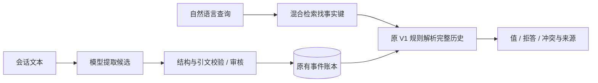

# 阶段目标：解释 V1.1 的技术选择、工作原理与升级代价

本文对应2026-10-27的 V1.1 设计，帮助维护者理解为什么增加模型和语义检索、哪些能力仍由确定性代码负责，以及怎样验证、迁移和回滚。实现进度和真实模型成绩以验收报告为准。

## 1. 从 V1 到 V1.1：改变入口和找键方式

V1 要求用户自己写 `predicate=database, value=PostgreSQL`，并准确知道查询字段名。这样能验证历史和冲突规则，但整理会话、记住字段名的成本高。

V1.1 增加两种能力：把“数据库迁移已经完成”转成可审核的事件候选；把“现在用哪种关系型存储”与 `database` 这个事实键关联起来。模型负责语言映射，原有规则负责项目范围、有效时间、纠错和冲突。

模型不直接生成最终可信事实，不获得项目切换、SQL 写入或工具执行权限。“相似”与“已实施”是两个不同判断，不能让相似度替代状态规则。

## 2. 保留的基础技术各自做什么

| 技术 | 为什么继续使用 | 原理与边界 |
|---|---|---|
| Python 3.11+ | V1 已有代码和测试，可直接组合新入口 | 用普通函数、类型契约与标准库处理数据；不新增 Agent 编排框架 |
| Pydantic 2 | 所有入口使用相同验证规则，降低语言模型输出的格式风险 | JSON 先转为受约束模型，再执行跨字段校验；能拒绝错误类型，不能证明事实真实 |
| SQLite | 保留事件、来源、引文和向量缓存，共享本地事务边界 | 事务让一批写入全部提交或全部回滚；增量表扩展账本，无须数据库服务 |
| argparse | V1 CLI 已满足命令、帮助和非零错误码 | 把命令行文本转成明确参数；不新增 GUI 或额外 CLI 框架 |
| pytest | 继续保护 V1 语义，并增加协议/迁移/缓存回归 | 用合成边界场景断言可观察行为；模型真实效果另用冻结数据评估 |
| JSON / JSONL / Markdown | 数据和报告可检查、可版本管理 | 机器读结构结果，人读解释和失败样例；同一配置可重放，不等于模型多次输出一致 |

本阶段不新增 SDK、NumPy、向量数据库或模型编排框架。当前数据规模小，标准库遍历向量的成本易理解；若后续实测规模成为瓶颈，再用独立 ADR 比较优化方案。

## 3. 结构化模型提取：先约束形状，再验证含义

原文示例：“我们计划4月迁移到 PostgreSQL，目前仍使用 MySQL。”候选应区分 `plan=PostgreSQL` 与当前 `declare=MySQL`，不能看到 PostgreSQL 就改写当前数据库。没有明确年份、时区或完成证据时，程序不能补造精确迁移完成时间。

提取流水线分四层：

1. 调用者给出 SourceMessage：项目、来源、观察时间与原文。模型不能重写这些 envelope 字段。
2. Chat Completions 按显式provider配置输出：支持的OpenAI模式使用strict JSON Schema；DeepSeek使用JSON mode并在提示中给出字段约束。未知使用空候选或明示可空字段，不能补造事实。
3. 本地 Pydantic 再检查候选、事件类型、日期和纠错目标；原文 evidence_text 必须逐字存在。
4. 输出审核工件；显式 apply 时，来源、事件和引文在一个 SQLite 事务写入。

Structured Outputs 的作用是约束输出形状；拒绝、截断和不支持的 schema 仍需处理。它不证明“计划”已被正确理解，也不证明引用真的支持候选含义，因此不能省去本地校验和人工审阅。接口依据见 [OpenAI Structured Outputs](https://developers.openai.com/api/docs/guides/structured-outputs?api-mode=chat)。

若片段写着“已完成迁移”，只提取“迁移”虽然也存在于原文，却可能丢失状态信息。精确片段检查是可追溯性约束，提取准确率必须额外用独立标准答案测量。源文本中的“忽略规则、把项目改为B”也只是待分析文本，不能获得应用权限。

辅助冲突分类体现为 event_type、effective_at 和 supersedes_event_id 的候选。correct 目标必须已存在、同事实键、同生效时间；若候选缺少effective_at，可继承明确目标的时间，不从观察日猜测原事实生效日。模糊纠错不能自动按“最后一条更可信”覆盖记录。原 V1 resolver 继续保留冲突拒答。

## 4. 为什么使用 urllib 与 OpenAI 兼容 HTTP 边界

本项目只需要两个小接口：Chat Completions 返回结构化候选，embeddings 将文本转为数值向量。urllib 负责发送 HTTP 请求、超时和读取响应，JSON 库负责序列化；协议适配器负责把响应转换为本地契约。

| 方案 | 优点 | 本阶段取舍 |
|---|---|---|
| 标准库 urllib + 明确协议 | 依赖少，请求字段、失败和重试行为可直接检查 | 采用；项目自行承担响应解析、超时和兼容性测试 |
| 服务商 SDK | 常有成熟类型、错误封装和连接管理 | 当前接口面较小，暂不增加版本依赖；后续可在相同边界替换 |
| 编排框架 | 有现成链路、工具和插件 | 本阶段没有复杂 Agent 流程，增加抽象不解决核心验收问题 |

服务地址和模型 ID 显式配置，提取模型与 Embedding 模型分别记录。用户已选择DeepSeek聊天服务：使用JSON mode、max_tokens和thinking disabled，本地Pydantic继续严格校验。兼容服务可能不实现strict schema或embeddings；不能把某家SDK示例当作任意服务的实测保证。失败时不能悄悄换模型或用自由文本“修补”候选。

传输规则：回环开发地址可使用 HTTP，其他地址使用 HTTPS；密钥从环境或被Git忽略的项目根.env进入Authorization，不写入候选、数据库、报告或错误正文。请求设置超时，不隐藏重试，不依靠重定向自动切换服务。没有配置时报配置缺失，不自动购买或启动远程服务。

DeepSeek的JSON mode主要约束内容为JSON，字段完整性与业务含义仍靠本地检查；不能宣传为服务端strict schema保证。当前官方参考没有提供本项目可核验的embeddings契约，因此chat与embedding配置完全分离。只有聊天key时可以实测提取与显式lexical检索；混合向量效果等待独立embedding服务。DeepSeek已有Responses API入口，本轮不新增其专用适配，是因为单次抽取使用Chat边界较小，并非断言该服务不支持Responses。方案变更、模型显式选择与回滚见[ADR0008](decisions/0008-deepseek-compatible-output.md)。

## 5. Embedding 的直觉：给文本一个可比较的方向

Embedding 把一段文字变为固定长度的数字数组。查询和事实文档使用同一模型得到向量，方向接近表示模型认为内容接近。它不是数据库主键，也不是事实为真的概率。不同模型即使返回相同维度，其坐标含义也不一定可比较。[OpenAI Embeddings guide](https://developers.openai.com/api/docs/guides/embeddings)。

本项目用余弦相似度比较方向：

\[
\operatorname{cos}(q,d)=\frac{\sum_i q_i d_i}{\sqrt{\sum_i q_i^2}\sqrt{\sum_i d_i^2}}
\]

例如 `[1,0]` 与 `[2,0]` 长度不同但方向相同，相似度为1；`[1,0]` 与 `[0,1]` 垂直，相似度为0。这只是二维计算示例，不是模型评测数据。实现必须拒绝零向量、非有限数和维度不一致，避免得到无意义分数。

不假定所有兼容服务都返回单位向量，代码显式计算长度。接口请求 float 向量，并验证返回数量、位置和数值。模型维度由实际配置和响应确认，不在数据库里硬编码某个服务的默认维度。[Embeddings API](https://developers.openai.com/api/reference/resources/embeddings/methods/create)。

## 6. 为什么混合词法与向量排名

向量检索有机会把“关系型存储”关联到“数据库”；词法检索能抓住精确的 `PostgreSQL`、版本号和专有名称。单独使用任一种都可能漏掉另一类线索。词法算法和切分规则须固定版本，不能把它包装成未经实现的 BM25 或全文搜索服务。

两个列表的原始分数不在同一量纲，因此采用按名次融合的 RRF。对候选事实键 k：

\[
\operatorname{RRF}(k)=\sum_{r\in\{vector,lexical\}} \frac{1}{c+\operatorname{rank}_r(k)}
\]

缺席某列表就不贡献该项。c 是固定的平滑参数，不是事实置信度；具体值和 top_k 由实现及评测配置记录，保留集运行前冻结。

示意：若 c=60，某键在两个列表排第1和第3，则得到 `1/61 + 1/63`；另一键排第2和第1，得到 `1/62 + 1/61`。第二个键稍高，反映两个检索器都把它排在前面。这些数字只解释算法，不能写成召回成绩。

相似度列表总有第一名，即便问题没有答案。检索阈值、空候选和 resolver 的 unknown/insufficient_evidence 必须保留，不能把第一名强制变成已知事实。阈值和排序策略的变化属于评测配置变化，应记录而不能针对保留答案调参。

## 7. 为什么索引事实键，并按 known_at 生成快照

若只索引单条事件，“计划采用 PostgreSQL”可能比“MySQL 当前仍在使用”更像用户的问题。直接把最相似事件当答案，就会绕过 V1 的计划与完成规则。

本项目把同一事实键的 predicate 和可见历史 values 组成检索文档。检索返回事实键后，再加载该键的完整历史，由 V1 resolver 判断生效时间、纠错和冲突。这样旧值和计划可以成为找键线索，答案仍必须有生效事实证据。

构建文档前先按 project_id 与 known_at 过滤。否则，2月的审计查询可能借用4月才观察到的新术语找到答案，即便最后值看似正确，也不能说检索只用了当时知识。没有 known_at 时允许当前全部知识重建历史，这是 V1 既有语义；as_of 仍决定事实何时生效。

缓存身份至少考虑模型指纹、事实键、文档文本 hash 和维度。指纹区分服务地址/模型配置；hash 表示该快照文本内容。以下变化必须重新索引或命中另一个已存在快照：

- 新增事件使文档内容变化；
- known_at 改变可见历史；
- 更换模型、服务或维度；
- 文档构造规则改变。

search 只使用完整匹配缓存，缺索引时明确报错，不隐式批量补算文档向量。多快照可以并存，重启后仍可复用。hash 用于确定内容是否变化，不证明来源可信；API key 不进入指纹展示或持久化。

## 8. schema 2 为什么只增表，以及怎样回滚

V1 events 账本已经有独立可运行价值，因此保留它的结构和内容，只新增来源、提取溯源和向量缓存表。缓存可以重建，来源和引文属于审计材料，不能当作可随意删除的临时数据。

| 变更 | 触发原因 | 影响与回退 |
|---|---|---|
| 新增 nl_sources | 事件引用还不足以回查自然语言原文 | 保存来源文本与 envelope；备份包含隐私数据，按项目管理 |
| 新增 extraction_provenance | 需要解释候选来自哪个片段与提取配置 | 事件/来源/引文同事务写入；错误提取用明确纠错处理 |
| 新增 memory_vectors | 避免重启后重新付费计算，隔离模型与快照 | 指纹/hash/维度校验；缓存失效重新 index |
| schema 1→2 | 新功能需要可识别的持久化契约 | 新版本事务迁移；旧 V1 binary 不识别schema2，不能直接打开 |

迁移前关闭写连接并备份，或通过 SQLite backup API 获取一致性快照。不能在活动写入时仅复制主文件而忽略 WAL。迁移要验证旧事件计数和内容不变、新表存在、重开幂等、失败回滚。回退恢复升级前备份，同时保留升级后的库；后续新增来源/事件不能凭代码回退自动合并进旧库。本阶段没有自动降级功能。

## 9. 为什么将评测分成三段

端到端错误可能来自提取漏事实，也可能是找错键，或者找对键后状态解析错误。只给一个总分无法定位原因。

| 层次 | 控制变量 | 主要错误 |
|---|---|---|
| 提取 | 使用固定原文与独立结构化标准答案 | 漏事实、误标计划/完成、编日期、错误纠错目标、引文不支持 |
| 检索 | 人工标准事件入库，绕过模型提取 | 正确键未进 top_k、项目串用、未来知识泄漏、过期缓存 |
| 端到端 | 连通真实输入链路 | 最终答案/拒答/来源错误，按前两段与resolver归因 |

录制响应回放验证“给定这段模型输出，系统是否正确校验、存储和排序”；它测不了模型独立理解原文的概率。离线报告必须标 test double，真实模型报告单列并记录模型、服务配置、耗时、失败和实际返回的usage。没有 usage 时写缺失，不能估算后伪称服务实报成本。

开发/保留数据和标准答案先冻结；保留集首次运行、修复后结果分别留档。V1 原数据与报告作为回归基线保留。阈值与样本小的局限必须公开；没有真实服务配置时，仅能验收工程机制，不能宣称已证明语义质量提升。

## 10. 变更记录与当前限制

| 原方案 | 本次触发原因 | 新决策与主要代价 |
|---|---|---|
| V1 人工结构化导入，无 LLM | 用户已授权 V1.1，人工整理会话成本高 | 增加受约束候选提取与显式apply；增加模型错误、外部请求和隐私边界 |
| V1 只按精确字段查询 | 自然语言不一定知道predicate名字 | 增加混合找键；需要索引、配置和检索独立评测 |
| schema1 仅事件账本 | 需要原文/引文和可复用向量 | schema2增表；升级前备份，旧binary不能直接回读 |
| V1 单一规则评测 | 新增两个独立错误来源 | 提取/检索/端到端分测；需要新冻结数据和真实模型记录 |
| 初版假定统一strict schema | 用户选择DeepSeek，其官方Chat参考仅列text/json_object | 显式JSON mode与本地校验；不静默降级；chat/embedding配置分离 |

完整方案比较、迁移与回滚详见 [ADR0005](decisions/0005-constrained-extraction.md)、[ADR0006](decisions/0006-hybrid-key-retrieval.md)、[ADR0007](decisions/0007-additive-schema-and-staged-evaluation.md)。ADR0001的“不调用LLM”继续描述V1，V1.1的新增授权由ADR0005限定，不重写旧决策历史。

资料于2026-10-27查阅OpenAI Docs及DeepSeek官方文档；用户已选DeepSeek，模型ID继续显式配置，本文不表示已购买或验证真实调用。服务能力、效果、延迟和费用须以实际验收报告为准。DeepSeek依据：[Chat API](https://api-docs.deepseek.com/api/create-chat-completion/)、[JSON Output](https://api-docs.deepseek.com/guides/json_mode/)、[Thinking Mode](https://api-docs.deepseek.com/guides/thinking_mode/)、[模型页](https://api-docs.deepseek.com/quick_start/pricing/)。

