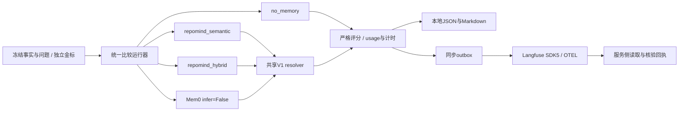

# 阶段目标：解释 V1.2 的公平后端对照、平台数据流及可核验交付边界

设计日期：2026-10-27；适用范围V1.2。新增MemoryProvider比较与Langfuse观测/实验，不改变V1/V1.1的事实时间、项目隔离和纠错规则。本阶段不实现真实代码Agent或Harness优化。

## 1. 为什么在此阶段增加平台能力

V1.1已能提取、索引、检索和解释事实，但一次报告里的错误仍需手工关联到provider、模型配置和输入版本。V1.2把这些上下文与逐题结果放进统一比较协议，并能同步到Langfuse查看；权威本地报告仍可独立使用。

Mem0在这里是一个受控检索实现；Langfuse是实验记录与查看平台。两者都不接管权威事件账本，也不代表本项目已成为编程Agent。

## 2. 什么才是公平比较

比较时“同模型”还不够。若一边有词法检索，一边只有向量；一边复用缓存，一边重新调用服务，最终质量、延迟和usage的差异就混合了多个原因。

| 变量 | 本项目的控制方式 |
|---|---|
| 输入 | 同一冻结fixture、query与fact-key文档，记录内容hash |
| 范围 | 先project_id与known_at过滤，再构建文档；as_of由共享resolver处理 |
| 向量 | 同provider/model/维度/参数；offline同bytes，live独立调用并披露向量hash差异 |
| 候选 | 同top_k和语义余弦门槛，明确SDK分数含义与边界 |
| 事实答案 | 共用V1 resolver，比较status/value/证据和拒答 |
| 缓存与延迟 | 隔离run目录、记录冷/热和运行顺序，不静默缓存后称更低成本 |
| 数据划分 | 先dev固定配置，再首次holdout；旧报告与金标保留 |

主比较是repomind_semantic与mem0。repomind_hybrid单列为增加词法/RRF的增强策略，不能用它的结果宣称某个存储后端更强。no_memory返回无证据结果，表示该固定任务对记忆的依赖，不是一个无记忆生成式Agent。

两种向量运行模式：

- offline recorded：双方收到相同人工录制向量字节，用于协议、排名、过滤和resolver连接验证。没有真实API调用，不能把0实际token解释成Mem0或缓存“省钱”。
- live：每variant拥有独立Embedding client，相同文本、模型与参数分别调用，记录实际请求/usage及输入和向量hash。服务逐次浮点或网络波动可能不同，报告需flag差异，不能把它们全部归因于后端。

本轮不增加第三种shared_live执行模式；它只能作为以后有独立协议时的研究选项。

## 3. Mem0 infer=False与公共配置边界

Mem0通常可以从消息抽取记忆；本实验刻意使用infer=False，直接写入同一fact-key文档，跳过其模型抽取。官方说明该模式保存原始输入，可能产生重复，因此每run索引生命周期、doc身份与重建策略都必须明确。[Mem0 ADD](https://docs.mem0.ai/core-concepts/memory-operations/add)。

本次锁定mem0ai2.2.1。实际wheel核验表明不能把任意embedder实例直接传给Memory，也没有可用的公开register_provider接口。因此不修改私有工厂、不冒称原生自定义注入。通过其公开OpenAI embedder配置访问本进程回环HTTP桥，再转到已有Qwen/recorded provider；桥接只适配Embedding协议，不新增LLM理解。

桥接的意义是让Mem0内部的真实add/search仍执行，同时沿用本项目明确的模型配置与usage计量。回环端只使用本地桥凭据，不传用户真实key；Qwen key留在既有外呼client。非Embedding路由拒绝，infer=False以外的LLM调用必须失败并暴露，不能悄悄发外网。

本地Qdrant与history路径显式归入run目录，首次import前设置MEM0_DIR并关闭MEM0_TELEMETRY。当前controlled锁环境不安装spaCy/fastembed可选模型组件；若检测到这些组件，明确失败并要求使用受控环境，避免其自动下载实体/BM25模型。此profile报告dense-only/optional features absent，未来启用多信号组件需新profile与独立报告。这样避免SDK默认home状态与遥测污染实验。官方overview列出默认history会写入用户目录，故不能只设置vector path就宣称完全隔离。[Mem0 OSS配置](https://docs.mem0.ai/open-source/overview)。

search使用公开filters限定user/run映射的项目快照；保留SDK返回排名与原始backend score。2.2.1具备内部多信号融合，当前profile因可选模型缺席走dense受控路径；保留backend score与explain.semantic_score，不能只凭最终score字段名当作余弦。共同门槛按semantic_score核验并统一严格边界。输入先共同把换行替换为空格，避免SDK内部规范化产生差异。报告结论限定当前profile，不能声称完整Mem0多信号或原生抽取/纠错能力。

上述公共接口与环境控制由锁版本SDK测试验证；升级SDK后需重新核验，网页main分支的说明不能代替该版本行为。每个Memory及拥有的Qdrant client都明确关闭，不能只关闭history SQLite就遗留本地索引锁。

## 4. 为什么采用Langfuse SDK5和OTEL

Trace是一次请求的执行路径，span是其中一个步骤，generation用于表达模型调用和实际usage。Dataset是固定输入与期望输出集合；experiment在相同集合上运行一个variant；score把本地严格评分和延迟等量化结果关联到相应item。

初步规划曾写“Python SDKv4+”。2026-10-27官方overview已列SDKv5，迁移文档说明v5将实验改为OTEL并移除旧dataset-run方法；一些reference仍残留latest-v4字样。本次锁Langfuse5.0.4并检查实际公开接口，避免只凭major下界判断兼容性。[SDK overview](https://langfuse.com/docs/observability/sdk/overview)、[v4→v5迁移](https://langfuse.com/docs/observability/sdk/upgrade-path/python-v4-to-v5)。

不自行发送legacy trace ingestion或dataset-run-items。trace/experiment使用SDK5的OTEL路径，dataset写入和核验读取使用该版本支持的Public API。官方已说明旧trace与dataset-run接口将在Langfuse Cloud于2026-11-16移除；分数接口的生命周期另有区别，不能笼统说整个ingestion端点所有类型都会消失。[弃用迁移表](https://langfuse.com/faq/all/deprecated-api-migration)。

同步预计算结果时，experiment task仅返回已存output，evaluator仅返回已存scores，不能为了“上传实验”再次调用Embedding或LLM。这样云端实验展示的内容对应已经完成的本地运行，模型usage不会因重放被重复归属到原实验。

SDK错误可能只被日志记录、缓冲写入可能异步，所以flush返回不等于云端持久化成功。必须继续读取新Observations/Experiments/Scores API并比对对象、输入hash和输出。Observations v2按时间范围与稳定ID过滤，处理分页、字段分组和IO字符串解析，不从“找到了同名trace”推断payload正确。

## 5. 为什么保留outbox而不把网络状态混进质量分数

评测结果已经在本地确定，云端不可用不应让用户重新付费跑模型。outbox保存本次要发送的安全payload、稳定身份与内容hash，重试只同步既有结果。

| 状态 | 含义 |
|---|---|
| pending/local_only | 本地已存，未证明服务接收 |
| sent_unverified | 尝试发送或flush，缺少完整服务侧核对 |
| verified | dataset、experiment、item、observation、score等必需对象已读回且payload匹配 |
| retryable_failure | 网络、权限、延迟或不匹配保留诊断，允许后续重试 |

这是至少一次投递，不是exactly-once承诺。稳定trace ID不能保证每个span都不重复；若上次部分成功，先读回并核对，只跳过已ACK内容。部分成功有分对象回执，不能用dataset ACK代替experiment或trace ACK。

SDK本地契约测试、离线回放、真实SDK执行与cloud验证要分开标记。没有Langfuse配置时本地功能继续工作，但平台联通状态应保持待验证。host与地区由用户显式配置，不预设或自动开通。

## 6. 实际usage与价卡成本怎样计算

“调用次数”“tokens”和“费用”是不同量。一个本地向量查询可以没有新token，却仍有CPU耗时；一次远程Embedding真实发生的用量则由服务usage决定。

每variant记录实际Embedding请求与返回usage，准备、索引、查询、resolver、平台同步分别计时。公共来源准备若仅执行一次，进入shared preparation；若各variant重新Embedding两次，则真实调用两次，分别归属。offline录制的0调用不代表真实服务免费，real_cost_verified保持false。

默认cost=null，表示未测费用。用户显式给价卡时才估算，价卡需模型/币种/单位/适用范围，以及输入、输出与缓存类别价格。以一百万token为单位的示意公式：

\[
C=\frac{U_{in}P_{in}+U_{cached}P_{cached}+U_{out}P_{out}}{10^6}
\]

公式中三类U必须互斥，输入usage若已包含cached，须先扣除已知cached再乘普通输入价；不能把总输入和cached再相加。若服务没有缓存拆分，而价卡对缓存和非缓存差别计价，就不能猜全部低价或直接当成已核验准确成本。报告保留usage并把估算缺失原因写清。

价卡计算得到的是按给定价格的估算，不是账单证明；不猜当前厂商价格、币种或免费额度。实验比较不自动购买服务，也不因查不到usage补造token。

## 7. 可选依赖为什么需要独立环境

V1.1基础仅需Pydantic与标准库；Mem0、Qdrant、Langfuse、OTEL会带来更多依赖与初始化行为。它们放入platform extra并延迟import，原有导入/查询不应触发SDK安装、遥测或home写入。

本轮平台环境锁Langfuse5.0.4、mem0ai2.2.1及实际解析依赖，安装与协议测试在隔离v12虚拟环境执行。版本号进入报告；升级后重做公共接口、分数、路径和云端读取契约测试。不将“pip安装成功”当成功接入平台。

SQLite仍是权威事件存储，Mem0本地索引和平台outbox使用独立run目录。停用V1.2可恢复V1.1环境和命令，保留新增报告与索引检查；不改写旧事件，不自动删除已同步云端对象。若只是禁用平台extra，不需要为了依赖回退降级SQLite schema。

## 8. 设计变更与尚未验证的边界

| 原方案 | 触发原因 | 新决策与代价 |
|---|---|---|
| 只有本地自研报告 | V1.2要求trace/dataset/experiment与对照 | 增加可选SDK/OTEL和同步状态，云端确认单独验证 |
| 假定v4+足以避免旧接口 | 当前官方SDK5迁移与deprecated实验路径 | 锁SDK5并核验源码/公开方法，增加版本兼容测试 |
| 直接公共customembedder注入Mem0 | 2.2.1公开构造与工厂不支持该假设 | 公共OpenAI配置加回环Embedding桥，禁止私有patch/隐式外呼 |
| 看一个总体质量分数 | 已知键召回可能掩盖未知误答 | 逐题、拒答、来源、分母与失败阶段独立报告 |
| 用缓存0token宣传成本优化 | 回放和live请求不在同一测量条件 | 分模式/variant实报usage，cost默认null |
| flush就视为同步成功 | SDK缓冲和云端异步可能无持久化证据 | outbox+服务读取核对，至少一次语义，不承诺exactly-once |

设计与公共源码核验不等于真实cloud持久化；同模型文本也不保证live向量逐次相同；小benchmark通过不能证明生产可靠性。原V1/V1.1数据和报告保持，新的dev/holdout由独立manifest冻结。实际交付以本地、SDK协议、live模型、cloud验证四类证据分别说明。

对应决策：[ADR0011](decisions/0011-langfuse-sdk5-and-optional-platform.md)、[ADR0012](decisions/0012-controlled-memory-provider-comparison.md)、[ADR0013](decisions/0013-usage-pricing-and-fair-measurement.md)、[ADR0014](decisions/0014-outbox-and-cloud-verification.md)。资料于2026-10-27核验官方文档与本次锁版本SDK研究，未读取.env、用户key或执行外部模型请求。

