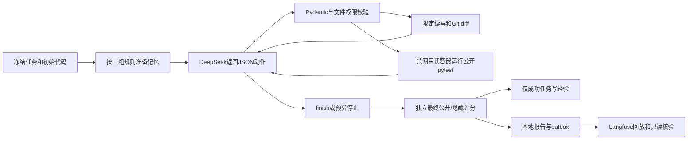

# 阶段目标：解释V2代码Agent的技术选择、实际原理和可验证边界

V2让记忆参与Python样例开发任务；本文件解释为什么加入容器和工具循环，以及它们如何与旧内核协作。保留V1/V1.1/V1.2，不实施OpenViking、分层上下文或自优化Harness。

## 一次代码任务如何完成

宿主控制器持有模型key；容器只看到样例代码、当次需要的测试和固定环境。隐藏判题在Agent停止后才挂载，不通过工具反馈送回模型。容器内仍是Python测试与被测代码共享解释器，所以本系统不声称可防御蓄意伪造pytest的提交。

## Docker为什么必要

普通Python子进程即使改变cwd，仍能读取宿主可访问文件、联网和启动其他进程。临时目录只防止误改路径，不能成为代码安全边界。本机已有Docker Desktop Linux引擎，因而选择容器，而非新增WASM解释器或依靠AST黑名单。

Linux namespace隔离进程、网络与挂载视图；cgroup限制内存、CPU和PID；非root与cap-drop降低权限；no-new-privileges禁止提权路径；只读root/项目/判题挂载防止运行代码回写宿主。只有限定大小的/tmp可写。镜像准备可以联网安装锁定依赖，模型测试阶段network=none且pull=never。不挂载Docker Socket，不提供host network或privileged。

每次测试使用随机容器名及所有权label。超时或输出超限会停止客户端并只清理同名、同label容器；清理无法确认时记工程故障。固定pytest入口返回测试计数和结束标记：仅退出0、无测试、全skip或提前os._exit(0)都不能直接判成功。它是完整性检查，不是无法伪造的安全判题协议。

容器共享Linux内核，不保证防内核漏洞；宿主Docker/镜像和控制器必须可信。本轮只对已知小样例执行生成代码，不接管任意外部仓库。真实隔离测试检查权限、只读、禁网、cgroup限制、超时/输出限制及容器清理，不能仅展示一串配置参数就宣称安全。

## 文件工具为什么仍要校验

模型建议的路径不是授权。工具只读任务副本内清单文件，只写任务声明的src文件；tests、.git、README和其他源码不可写。绝对路径、父目录、盘符、Windows ADS、链接/junction/reparse point和hardlink被拒绝。受保护文件hash在操作前后核对。模型没有创建链接或执行宿主命令的工具。

Git diff用固定参数、禁用external diff/textconv和全局配置继承，只检查样例副本的源文件。它不会提交、push、运行项目钩子或改变用户当前仓库。对同账户恶意宿主进程的并发文件竞争不作防御承诺。

## 为什么用小型JSON动作协议

现有DeepSeek已支持JSON Object模式，传输、独立key和usage记录在旧版实测。V2单独定义动作schema，重用传输，不改提取模块的系统提示词。合法JSON之后仍必须通过Pydantic字段和工具权限检查；模型不能用额外字段把run_tests变成任意shell。

固定有限循环比引入通用Agent框架更容易检查：最多6轮、每批4动作、公开测试最多3次、总20动作、上下文24K字符。finish必须单独出现。格式错误给有限schema诊断供下一轮修正；网络/认证等传输错误终止该任务，避免盲目付费重试。达到预算会明确标状态，不伪造完成，也不偷偷扩大预算。

“任务成功”看正常finish、源码实际变更、最终公开与隐藏测试均通过、文件/执行完整性成立。模型文字声称通过不参与判定。重试率定义为该任务公开测试工具调用超过一次的比例；它也会把测试先行工作流计作额外测试，不等于推理能力差。

## 三组记忆怎样区别

| 组 | 输入历史 | 时点 | 经验 |
|---|---|---|---|
| baseline | 不注入历史 | 无事实检索 | 无 |
| memory | 显式键检索当前事实 | 冻结当前快照2026-10-01 | 无 |
| enhanced | 同样键但按任务查询 | 任务as_of/known_at | 同run、同项目、更早成功任务，最多3条 |

使用旧V1 resolver处理计划/完成、纠错和双时间，键路由来自固定任务注释，不把代码金标交给模型。这样本轮可以主要观察执行工具与记忆时点的作用，避免V1.2语义检索主体歧义成为额外混杂；语义检索弱点并未因此被修好。

经验存到独立SQLite库，成功后记录任务、项目、分类、run和公开交互总结。相同分类优先，其他同项目近期经验作回退；不加载其他项目或未来任务。dev与holdout经验不共享。增强组同时改变时序与经验，不能分别归因；当前记忆组的定义也不代表所有Memory Agent。

## 测量为什么要保存原始轨迹

每次模型请求深拷贝当时的消息历史，并记录真实usage、请求数、所请求和服务返回的模型名称、耗时与失败。否则后续追加工具结果可能倒填进早先请求记录，破坏计量解释。没有响应usage时不猜0；无有效价卡时货币金额保持null。

Langfuse沿用V1.2 SDK5/OTEL和token字段标准化。新增developer_task阶段参与dataset/experiment导出；Agent任务执行与云端回放分开。模型generation只在trace路径计量，experiment用span保存原计数metadata，避免把回放当新的推理。flush不等于服务持久化，必须读回输出/评分/计数和payload身份；异步可见时用verify-only，不重复上传推进状态。

## 技术变更和回滚

新增Docker是因为V2开始运行代码，旧版不执行模型代码无需它；旧命令仍无需Docker。新增SQLite经验库不改核心事件schema。新增JSON工具协议不引入Agent框架，也不让模型取得宿主shell。依赖继续使用既有已测版本，测试镜像另锁pytest与配套包。

输入r2只补明dev-01既有异常契约，隐藏断言字节不变，原始数据/首轮成绩保留；详见ADR0019。修订前后成绩变化不能全部算作系统改进。

停用agent命令即可回到V1.2；保留任务副本、经验库、outbox和镜像记录。回滚不自动删除Docker镜像、旧发布包或云端对象。参考：[Docker运行](https://docs.docker.com/engine/containers/run/)、[DeepSeek JSON模式](https://api-docs.deepseek.com/guides/json_mode/)、ADR0016–0019。
